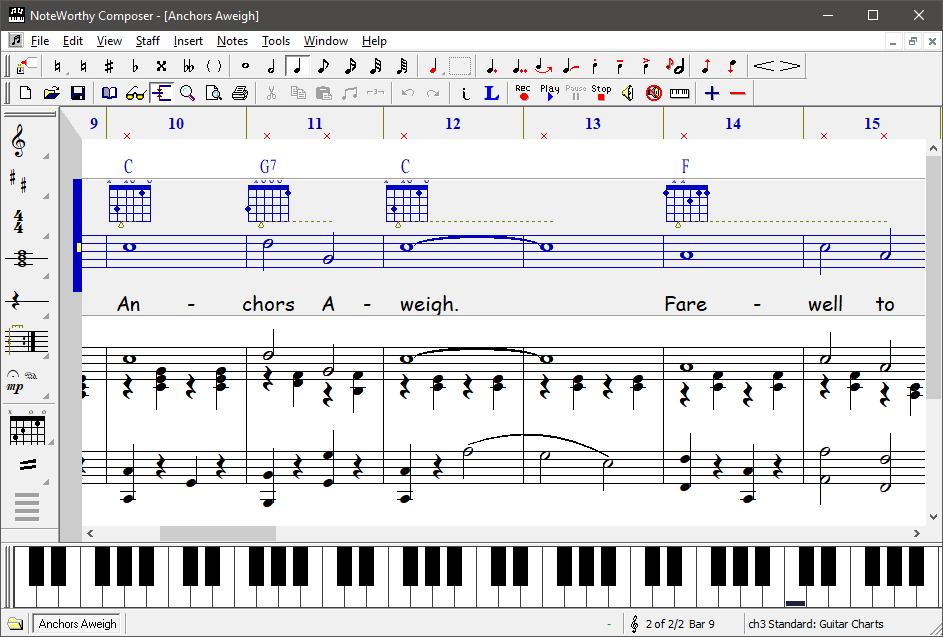
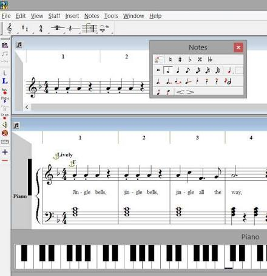

# NoteWorthy Composer Scores for Practice and Performance

NoteWorthy Composer turns musical ideas into editable notation, printed parts, and MIDI performances.
Build a rehearsal copy that lets a player follow the same notes, rhythms, and cues you hear during playback.

## A rehearsal copy begins with the editable score

Save the working arrangement as an NWC file before preparing anything for another musician.
Keep a separate revision when changing instrumentation, transposing a part, or shortening a rehearsal passage.

The editor supports entry through the computer keyboard, mouse, on-screen piano, and MIDI input.
Choose an input method for the passage, then check note values and staff placement before adding detail.
The [product overview](https://noteworthycomposer.com/) describes the notation, playback, and printing workflow.

For repeatable exports, the built-in converter accepts input and output filenames.
With the installed `nwc2.exe` available on PATH, these PowerShell commands create text and MIDI copies:

```powershell
nwc2.exe -convert ".\Scores\rehearsal.nwc" ".\Scores\rehearsal.nwctxt"
nwc2.exe -convert ".\Scores\rehearsal.nwc" ".\Scores\rehearsal.mid"
```

Use existing input files and a writable destination folder; review both outputs after conversion.
The [conversion discussion](https://forum.noteworthycomposer.com/?topic=9511.msg67822) records the supported syntax.

[](https://noteworthy-composer.github.io/NoteWorthy-Composer/)

## Read the notation, then listen to the phrase

### Spelling and duration

A pitch can sound right while its written spelling makes the harmony harder to read.
Check accidentals in context, especially after transposition or importing a performance.
Count each bar independently before adjusting expressive timing.

- [pitch.md](docs/old_docs/pitch.md) relates note names and octaves to MIDI pitch numbers.
- [tpc.md](docs/old_docs/tpc.md) explains how enharmonic spelling differs from sounding pitch.
- [ticklength.md](docs/old_docs/ticklength.md) describes relative note and rest durations in ticks.

### Playback as a second reading

Listen to entrances, ties, repeated passages, and the relationship between melody and accompaniment.
A different MIDI sound can change the impression of balance without changing the written notes.
Record the playback device or sound set when comparing two revisions.

- [DownloadSoundFont.cmake](buildscripts/cmake/DownloadSoundFont.cmake) shows version checks and retrieval of a playback soundfont.
- [mscore.1.in](buildscripts/packaging/Linux+BSD/mscore.1.in) provides a notation editor command-line manual source, including export options.



## Move a score across applications

Use NWCTXT when you need a readable representation for comparison or processing.
For an interchange experiment, install Python and music21 in a separate working environment.
This example reads the exported text score and writes a MusicXML copy:

```python
from music21 import converter

score = converter.parse("Scores/rehearsal.nwctxt")
print("Parts:", len(score.parts))
score.write("musicxml", fp="Scores/rehearsal.musicxml")
```

The [music21 converter documentation](https://music21.org/music21docs/moduleReference/moduleConverterSubConverters.html#converternoteworthy) confirms NWCTXT input.
Open the result in the receiving editor and compare a short passage before converting a complete collection.
Pay particular attention to repeats, lyrics, articulations, and layout; conversion requires a musical review.

| Recipient needs | Prepare | Check before sending |
| --- | --- | --- |
| Continued editing in NoteWorthy Composer | NWC working copy | Revision and required fonts |
| Inspection or scripted processing | NWCTXT export | Staff order and notation content |
| A performance for a sequencer | MIDI export | Tempo, program choices, and playback |
| Interchange through music21 | MusicXML conversion | Notes, rhythms, and supported markings |

MIDI carries performance information and does not preserve a complete page layout.
Keep the editable score alongside every derived delivery copy.

## Proof the page at real size

Print a representative page before distributing a long score.
Inspect dense measures, lyric alignment, accidental spacing, and the beginning of each system.
Make sure the paper size and scale match the intended music stand or rehearsal folder.



For implementation study, the engraving sandbox exposes a small score setup and font interfaces:

- [main.cpp](sandbox/engraving/main.cpp) creates a score and registers a font provider in a minimal application.
- [fontproviderstub.h](sandbox/engraving/fontproviderstub.h) declares symbol-font and text-metric interfaces.
- [fontproviderstub.cpp](sandbox/engraving/fontproviderstub.cpp) supplies placeholder implementations for those interfaces.
- [config.h](sandbox/engraving/config.h) contains a sandbox version definition.

A placeholder font provider cannot establish whether a printed page will be readable.
Use the actual installed fonts and an actual output page for the final decision.

- [generate_pngs.sh](buildscripts/ci/vtests/generate_pngs.sh) orchestrates image generation for visual score tests.
- [run.in](buildscripts/ci/vtests/run.in) launches a test executable with offscreen Qt settings.
- [i18n.md](docs/old_docs/i18n.md) discusses plugin translation strings and language resources.

## Try one automation task on a short passage

NoteWorthy Composer offers user tools and Lua object plugins for extending a notation workflow.
Start with a disposable copy of a few measures and one specific operation.
Read the [User Tool API](https://lua.noteworthycomposer.com/usertool/) and the [official plugin API repository](https://github.com/nwsw/nwcplugin-api) for the native extension interfaces.

When comparing extension designs, the supplied documentation covers several useful boundaries:

- [plugins.md](docs/old_docs/plugins.md) introduces QML plugin structure and debugging.
- [plugins2to3.md](docs/old_docs/plugins2to3.md) illustrates API changes that affect older plugins.
- [Home.md](docs/apidocs_static/Home.md) distinguishes forms, macros, and composite extensions.
- [1_getting_started.md](docs/apidocs_static/tutorials/1_getting_started.md) walks through a first nonvisual extension.
- [2_manifest.md](docs/apidocs_static/tutorials/2_manifest.md) describes extension identity and action declarations.
- [3_form.md](docs/apidocs_static/tutorials/3_form.md) introduces QML interfaces for form extensions.
- [4_macros.md](docs/apidocs_static/tutorials/4_macros.md) explains script actions and entry points.
- [tutorials.json](docs/apidocs_static/tutorials/tutorials.json) maps tutorial identifiers to their displayed titles.

Check the host application and API version before adapting an extension.
Keep the original passage available so that the effect of each operation remains easy to inspect.

## Record what went to the players

A small JSON handoff note can accompany the score; the fields below are an example record format:

```json
{
  "score": "rehearsal.nwc",
  "revision": "B",
  "purpose": "section rehearsal",
  "checks": ["printed page", "MIDI playback", "staff names"]
}
```

Include the intended instrumentation and any special font requirements in the delivery message.
For recipients who only need to read, play, or print, the [NoteWorthy Composer Viewer](https://noteworthycomposer.com/nwc2/viewer.htm) supports those tasks.
Ask the recipient to open the delivered copy before rehearsal and report any missing symbols or unexpected playback.

The linked local reference files originate from MuseScore and include material for different API generations; they accompany this guide as implementation studies.
The Python example uses music21, the conversion commands use NoteWorthy Composer, and the JSON is a proposed handoff record.

## Related Search Terms

NoteWorthy Composer, NoteWorthy Composer, nwc composer, noteworthy composer 2, noteworthy composer 2.75, music-notation, sheet-music, midi, musicxml, scorewriter, composition, music-education, music-theory, notation-editor, windows
